# safeRL: safe reinforcement learning on a lane-free highway

<!-- TODO: paper title, authors, venue, and PDF link. -->

## Overview

A PPO agent drives on a lane-free highway: a periodic 380 m by 10.2 m road
with no lanes, shared with 40 vehicles following MTM traffic dynamics. The
policy outputs continuous longitudinal and lateral acceleration. A high-order
control barrier function (HOCBF) filter can correct that command before it
reaches the simulator.

The study separates what the policy learns from what the shield supplies:

- **CBF-OFF** evaluates the policy's own actions, with no shield.
- **CBF-ON** evaluates the policy together with the deployed HOCBF shield.

## Policies compared

| Label | Policy | Variant | How safety enters training |
| --- | --- | --- | --- |
| A1 | Nominal PPO | `ppo_nominal` | None: the nominal reward only |
| B1 | HOCBF State-Cost | `ppo_hocbf_state_cost_raw` | Fixed HOCBF state-cost penalty in the reward; trained without the shield |
| B2 | HOCBF Actor-Loss | `ppo_cbf_nd_reward_actor` | Actor loss toward the shield's safe action, with the shield in training |
| C0 | HOCBF CMDP | `ppo_cmdp_collision` | Constrained PPO: a Lagrange multiplier keeps an episodic collision cost under a budget; trained without the shield |
| C1 | Differentiable projection | `ppo_cbf_diff_reward_only` | Differentiable projection plus reward (videos and robustness plots only) |
| C2 | Differentiable projection + loss | `ppo_cbf_projected` | Differentiable projection plus actor loss (robustness plots only) |

## On the highway

Each policy driving in the full 40-vehicle traffic. The ego vehicle is
green. The left clip has the shield off (CBF-OFF) and the right clip has it on
(CBF-ON). In these videos a collision does not end the episode: it is counted,
and the vehicles stay on the road and keep driving.

  

CBF-OFF

CBF-ON

  
A1

  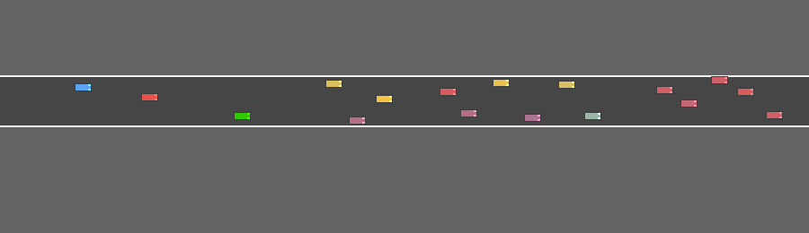
  
  
B1

  
  
  
C1

  
  

## Scenarios

Fixed diagnostic scenes that each test one driving decision. Every policy
starts from the same scene, with the shield off and on. The camera follows the
green ego vehicle. As on the highway, a collision is counted but does not end
the episode, so every clip runs the same length.

### Open passing gap

A passing gap is available; compare which policies actually commit to it.

  

CBF-OFF

CBF-ON

  
A1

  
  
  
B1

  
  
  
B2

  
  

### Boxed in

Both nearby side gaps are occupied; the policy should not force a pass.

  

CBF-OFF

CBF-ON

  
A1

  
  
  
B1

  
  
clip not available

  
B2

  
  

### Rear pressure

A fast rear vehicle closes on the ego, which should move toward the cleaner
side gap.

  

CBF-OFF

CBF-ON

  
A1

  
  
  
B1

  
  
  
B2

  
  

### Boundary recovery

The ego starts near the road edge behind a slow blocker and should recover
inward.

  

CBF-OFF

CBF-ON

  
A1

  
  
  
B1

  
  
  
B2

  
  

### Sudden lead slowdown

The leader slows sharply; the ego should react without diving into occupied
side gaps.

  

CBF-OFF

CBF-ON

  
A1

  
  
  
B1

  
  
  
B2

  
  

## Robustness

How close each policy's own action comes to breaking the safety constraints,
over ten diagnostic scenarios. The plotted quantity is the HOCBF margin of the
raw policy action,

SHOCBF(t) = mini [ bi(t) − Ai(t) uraw(t) ],

the smallest slack across every vehicle-pair and road-boundary constraint.
Above the dashed zero line, the raw action satisfies every constraint; below
it, at least one is violated and a shield would have to correct it. Curves are
means over seven rollouts per policy, with the standard error shaded. A
rollout contributes no data after it crashes, so a curve that stops early
means no rollout of that policy was still running.

  <figure>
    <a href="media/margins/open_road_no_nearby_traffic.png">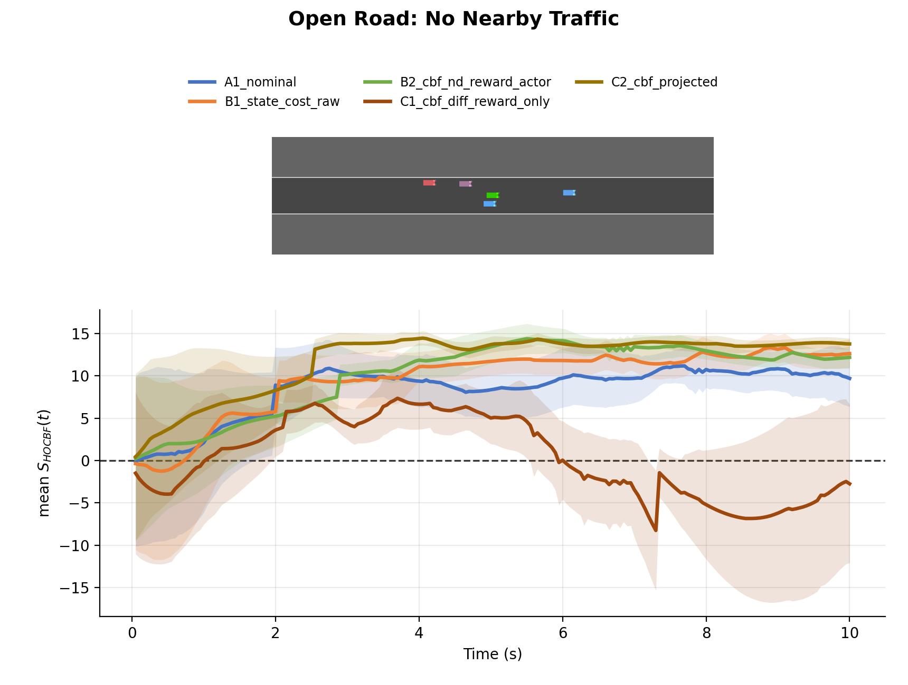</a>
    <figcaption>No nearby vehicles: steady progress with little drift and near-zero correction is expected.</figcaption>
  </figure>
  <figure>
    <a href="media/margins/open_passing_gap_overtake_diagnostic.png">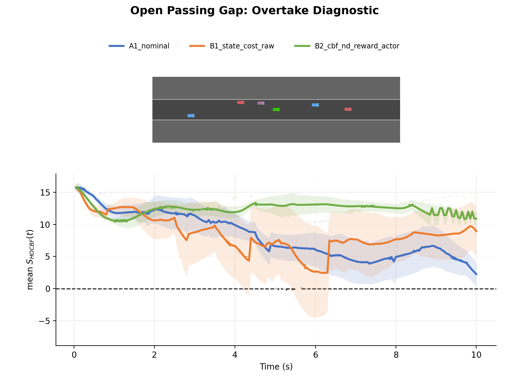</a>
    <figcaption>A passing gap is available.</figcaption>
  </figure>
  <figure>
    <a href="media/margins/reject_overtake_fast_closing_vehicle.png">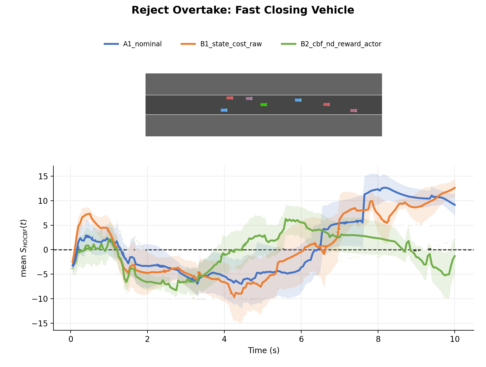</a>
    <figcaption>The tempting gap holds a fast closing vehicle and should be rejected.</figcaption>
  </figure>
  <figure>
    <a href="media/margins/tight_slot_trap_shield_correction.png">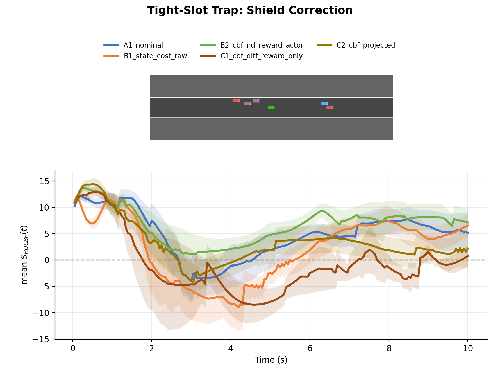</a>
    <figcaption>A tight slot the policy should not dive into.</figcaption>
  </figure>
  <figure>
    <a href="media/margins/boundary_recovery_road_edge_squeeze.png">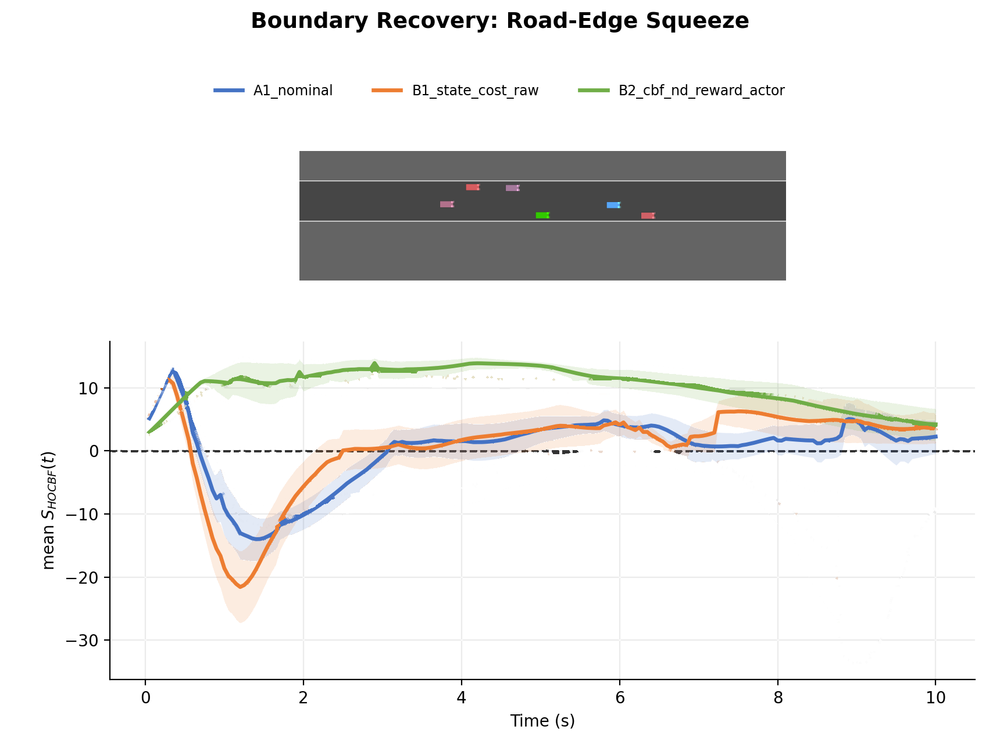</a>
    <figcaption>Recover inward from the road edge past a slow blocker.</figcaption>
  </figure>
  <figure>
    <a href="media/margins/boundary_recovery_opposite_edge.png">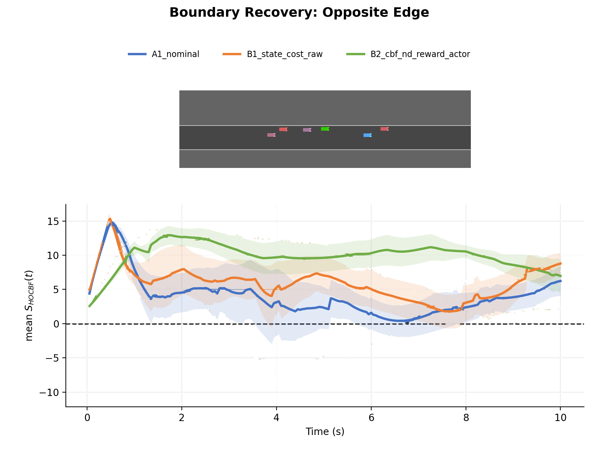</a>
    <figcaption>The same recovery from the opposite road edge.</figcaption>
  </figure>
  <figure>
    <a href="media/margins/boxed_in_no_clean_gap.png">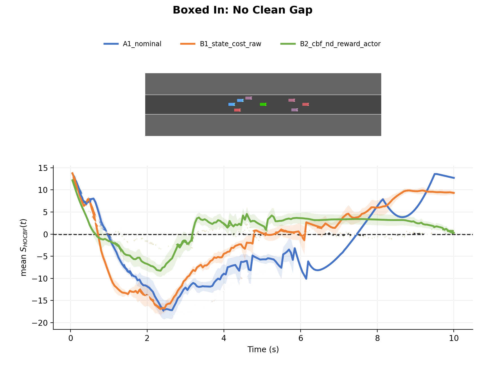</a>
    <figcaption>Both side gaps are occupied; no pass should be forced.</figcaption>
  </figure>
  <figure>
    <a href="media/margins/rear_pressure_escape_closing_car.png">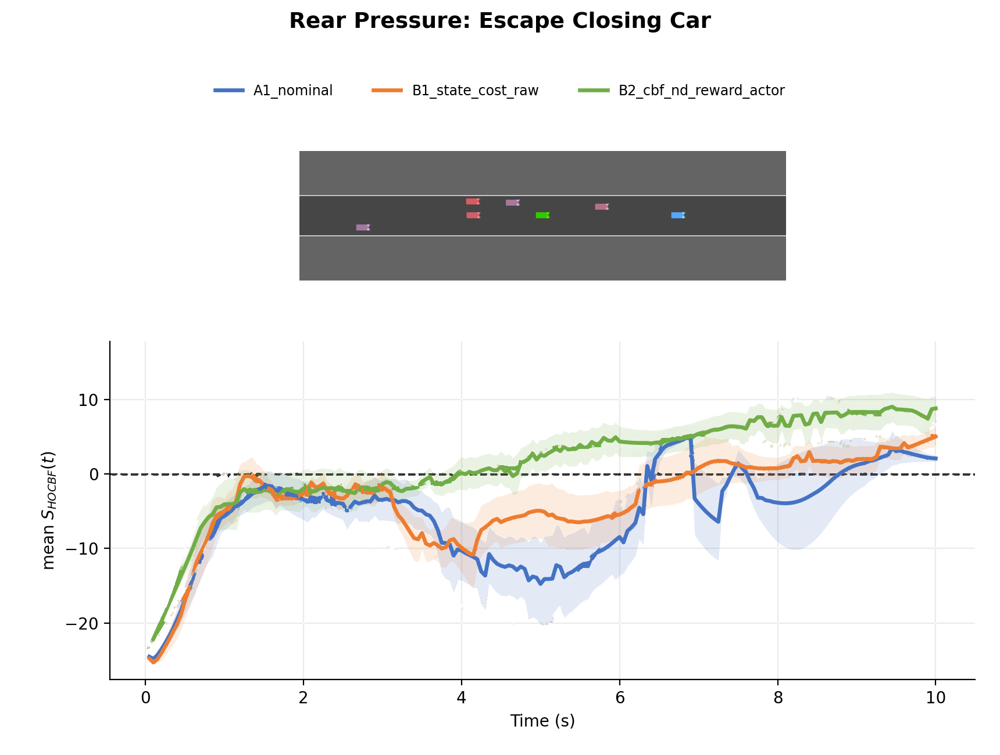</a>
    <figcaption>A fast rear vehicle closes on the ego.</figcaption>
  </figure>
  <figure>
    <a href="media/margins/sudden_lead_slowdown_reactive_safety.png">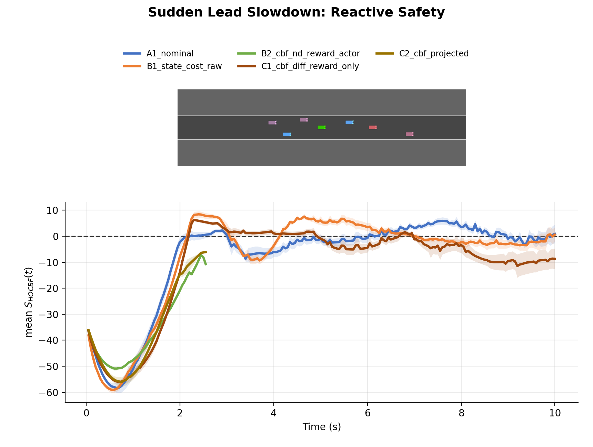</a>
    <figcaption>The leader slows sharply.</figcaption>
  </figure>
  <figure>
    <a href="media/margins/staggered_traffic_pick_clean_gap.png">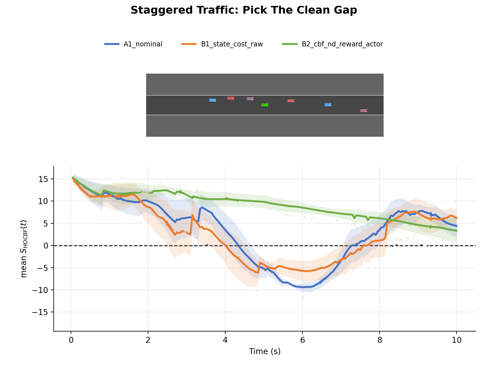</a>
    <figcaption>Thread through staggered traffic via the clean side.</figcaption>
  </figure>

## Results

Every policy is evaluated twice: with the shield off (CBF-OFF, the policy
alone) and on (CBF-ON, the policy plus the deployed HOCBF shield). An episode
completes only if the ego covers 1,000 m without a collision within 3,000
policy steps; in these evaluations a collision ends the episode. Entries are
means with 95% confidence intervals.

**Without the shield, only B2 is significantly safer than nominal PPO**: 2.55
against 4.04 collisions per km (p < 0.01), with higher return and nearly three
times the completion rate. **With the shield on, every policy lands at
0.24–0.30 collisions per km**, but B2 leans on it least: the shield intervenes
on 23% of its steps against 62% for A1 (p < 0.05), with the smallest
corrections.

### Table II: CBF-OFF evaluation

  <table class="results">
    <thead>
      <tr><th>Policy</th><th>Coll./km ↓</th><th>Return ↑</th><th>Completion ↑</th><th>Speed err. ↓</th><th>Lat. err. ↓</th><th>Jerk ↓</th></tr>
    </thead>
    <tbody>
      <tr><th scope="row">Nominal PPO (A1)</th><td>4.04[3.33, 4.74]</td><td>208.5[159.1, 258.0]</td><td>0.036[0.019, 0.053]</td><td>2.07[1.82, 2.32]</td><td>1.99[1.09, 2.90]</td><td>3.44[2.43, 4.46]</td></tr>
      <tr><th scope="row">HOCBF State-Cost (B1)</th><td>3.74[3.27, 4.22]</td><td>259.2[232.4, 286.0]</td><td>0.056[0.027, 0.085]</td><td>1.76[1.45, 2.07]</td><td><strong>0.84</strong>[0.78, 0.90]</td><td>4.45[2.40, 6.50]</td></tr>
      <tr><th scope="row">HOCBF Actor-Loss (B2)</th><td class="key">2.55**[2.15, 2.95]</td><td class="key">354.2***[314.5, 393.8]</td><td class="key">0.103**[0.070, 0.136]</td><td><strong>1.41</strong>**[1.33, 1.49]</td><td>1.09[0.88, 1.30]</td><td><strong>1.83</strong>*[1.62, 2.04]</td></tr>
      <tr><th scope="row">HOCBF CMDP (C0)</th><td>3.72[2.21, 5.24]</td><td>222.6[57.2, 387.9]</td><td>0.038[−0.012, 0.089]</td><td>2.20[1.61, 2.78]</td><td>1.89[−0.73, 4.52]</td><td>5.34[0.86, 9.83]</td></tr>
    </tbody>
  </table>

### Table III: CBF-ON evaluation

  <table class="results">
    <thead>
      <tr><th>Policy</th><th>Coll./km ↓</th><th>Interv. ↓</th><th>Corr. ↓</th><th>Return ↑</th><th>Completion ↑</th><th>Speed err. ↓</th><th>Lat. err. ↓</th><th>Jerk ↓</th></tr>
    </thead>
    <tbody>
      <tr><th scope="row">Nominal PPO (A1)</th><td>0.30[0.22, 0.38]</td><td>0.62[0.40, 0.84]</td><td>0.308[0.108, 0.508]</td><td>699.9[600.9, 799.0]</td><td>0.754[0.697, 0.810]</td><td>1.94[1.59, 2.29]</td><td>2.13[1.23, 3.03]</td><td>6.17[5.09, 7.25]</td></tr>
      <tr><th scope="row">HOCBF State-Cost (B1)</th><td>0.28[0.26, 0.31]</td><td>0.37[0.34, 0.40]</td><td>0.210[0.166, 0.253]</td><td><strong>814.4</strong>[800.7, 828.0]</td><td>0.766[0.745, 0.786]</td><td>1.67[1.56, 1.78]</td><td><strong>1.00</strong>[0.93, 1.07]</td><td>7.85[5.60, 10.10]</td></tr>
      <tr><th scope="row">HOCBF Actor-Loss (B2)</th><td>0.24[0.21, 0.27]</td><td class="key">0.23*[0.21, 0.24]</td><td class="key">0.063[0.059, 0.066]</td><td>810.0[788.7, 831.3]</td><td>0.797[0.773, 0.821]</td><td><strong>1.50</strong>[1.44, 1.56]</td><td>1.29[1.13, 1.44]</td><td><strong>4.34</strong>*[4.09, 4.59]</td></tr>
      <tr><th scope="row">HOCBF CMDP (C0)</th><td>0.24[0.20, 0.28]</td><td>0.64[0.04, 1.23]</td><td>0.347[−0.126, 0.820]</td><td>732.0[472.1, 992.0]</td><td><strong>0.800</strong>[0.767, 0.833]</td><td>1.91[1.50, 2.31]</td><td>1.85[−0.48, 4.19]</td><td>7.60[3.19, 12.01]</td></tr>
    </tbody>
  </table>

Mean [95% CI]. *p &lt; 0.05, **p &lt; 0.01,
***p &lt; 0.001, Holm-corrected against A1. Boxed values are the
primary outcomes in Table II and reduced filter dependence in Table III; bold
marks the best value in a column. Interv.: share of steps where the shield
changed the action. Corr.: size of its correction. Speed and lateral errors are
in m/s and m.

## Documentation

A [short guide to the work and the code](documentation.html): the problem,
the shield, the evaluation, and the commands that reproduce this page. The
full documentation is in the
[repository](https://github.com/AhmadAssaad711/safeRL), starting with the
[experiment contract](https://github.com/AhmadAssaad711/safeRL/blob/main/safeRL_workspace/docs/lanelessKaralakou_reference.md).
